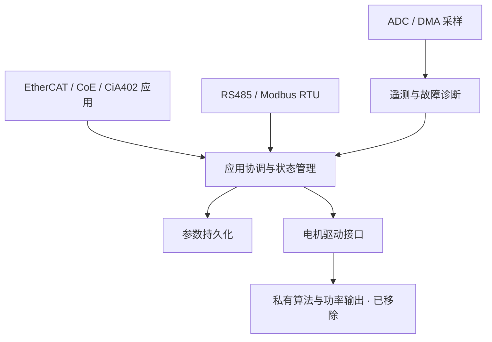

# 架构说明

## 原工程的模块协作

原工程在初始化时建立系统时基、通信外设、EEPROM、ADC/DMA、诊断与驱动状态，再启动周期性电机任务。前台循环负责 EtherCAT 应用轮询、Modbus 报文、遥测更新、参数保存及故障处理；周期中断承接实时控制工作。

图中呈现原工程模块职责。公开源码重点覆盖 Modbus 通信和外围硬件访问；应用协调、遥测换算、参数结构及实时驱动部分仅保留职责说明。

## 公开版的可执行路径

`modbus.c` 仅通过三个传输函数访问底层：`rs485_init()`、`rs485_read()`、`rs485_send()`。公开版将原聚合头替换为显式接口，从而在主机上验证相同的协议实现。

`ports/n32/` 提供嵌入式端阅读样例。RS485 DMA、CAN、EEPROM、QSPI 保留各自的硬件处理结构，设备 SDK 依赖集中在 `board_sdk.h`。

电机后端接口为本次公开展示新增。它接收通用命令结构，返回已脱敏状态，整个实现保持输出关闭。原算法的内部符号、查表数据和参数布局均已移除。

## 时序与故障处理的阅读重点

- RS485：DMA 发送完成后打开 UART TXC 事件，在移位寄存器完成发送后释放收发方向引脚。
- Modbus：前台累积输入，完成长度与 CRC 检查后再分发功能码；多寄存器写入在范围检查通过后执行。
- EEPROM：按设备页边界分段写入，通过 ACK 轮询等待写周期完成，传输错误走统一的清理路径。
- QSPI：等待操作设置退出条件，保留首次错误及累计诊断信息，便于追踪 PDI 通信问题。
- CAN：在硬件 FIFO 接收事件中取出报文并调用回调，上层回调应保持短时执行。
