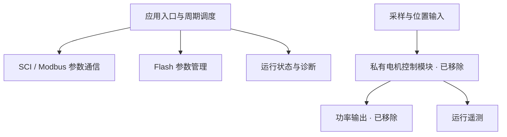
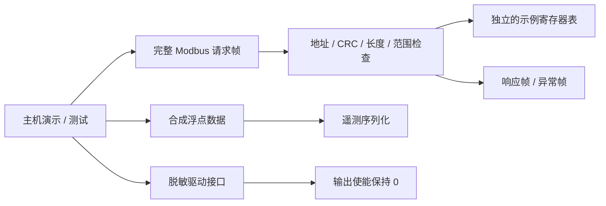

# 项目架构

## 原工程职责

项目结构及可读副本显示，工程按应用入口、控制模块、通用模块、设备驱动与编译配置组织。应用入口协调初始化与周期任务；外设层提供 SCI、采样、PWM、编码器与定时器访问；控制模块承担实时驱动与故障处理；串口与存储模块承担参数交互。

图中保留职责关系。控制函数、参数字段、寄存器映射、采样换算、保护阈值及功率输出配置均已从公开内容中移除。

## 公开版执行路径

协议函数接收完整 RTU 帧，调用方负责实际链路的分帧与传输。主机样例直接传入内存字节数组；SCI 摘录展示硬件中断向缓存移交字节的关系。

遥测接口由调用方传入独立数据，按二进制浮点小端序写入输出缓冲，并追加公开帧尾。公开示例使用合成数值。

电机接口保留调用形式与状态查询，真实驱动实现已移除，所有演示调用都保持输出关闭。
